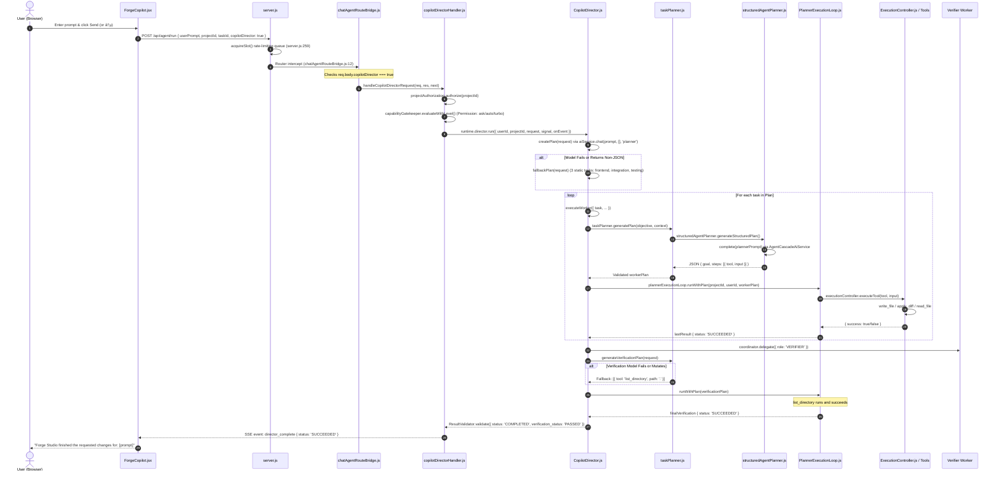

# Production Execution Path & Architecture Map (Phase 0)

**Branch Baseline:** `audit/phase-0-execution-path-baseline-2026-10` (tracked to `origin/main` @ `76efa666d809c381d61579de5fa7c9d31f6a5a53`)
**Investigation Date:** 2026-10-15
**Subject:** End-to-end trace of user requests in Forge Studio / AI Dost 3.1 to identify generation bottlenecks, fallbacks, and quality divergence.

---

## 1. Canonical Production Path: Forge Studio UI Action to Generated Code

The canonical execution path used by the real Forge Studio IDE interface is traced below through exact source files, export names, and call sites.



### Call-Chain Breakdown

1. **Frontend Action & State:**
   - **Source:** [`frontend/components/forge/ForgeCopilot.jsx`](file:///c:/Users/vikash%20kumar/Pictures/ai%20dost%203.1/frontend/components/forge/ForgeCopilot.jsx#L2910-L2946)
   - **Trigger:** `handleSend()` invoked on composer submit.
   - **Payload:** `POST /api/agent/run` with body:
     ```json
     {
       "userPrompt": "Build a SaaS dashboard...",
       "projectId": "default",
       "taskId": "forge-1792064954477",
       "copilotDirector": true,
       "permissionLevel": "auto",
       "preferredModel": "auto"
     }
     ```
2. **Backend Entry & Interception:**
   - **Source:** [`backend/server.js:259`](file:///c:/Users/vikash%20kumar/Pictures/ai%20dost%203.1/backend/server.js#L258-L278) (rate-limiting slot acquisition).
   - **Bridge:** [`backend/chatAgentRouteBridge.js:12`](file:///c:/Users/vikash%20kumar/Pictures/ai%20dost%203.1/backend/chatAgentRouteBridge.js#L9-L16).
   - `createChatTaskAwareHandler` checks `if (req?.body?.copilotDirector) return directorHandler(req, res, next)`.
   - **Controller:** [`backend/agent/runtime/copilotDirectorHandler.js`](file:///c:/Users/vikash%20kumar/Pictures/ai%20dost%203.1/backend/agent/runtime/copilotDirectorHandler.js#L27-L177).
3. **Supervisor Orchestration:**
   - **Source:** [`backend/agent/runtime/CopilotDirector.js:237`](file:///c:/Users/vikash%20kumar/Pictures/ai%20dost%203.1/backend/agent/runtime/CopilotDirector.js#L237-L263).
   - Instantiated via `getCopilotDirectorRuntime` in [`backend/agent/runtime/createChatTaskGateway.js:134`](file:///c:/Users/vikash%20kumar/Pictures/ai%20dost%203.1/backend/agent/runtime/createChatTaskGateway.js#L134-L165).
   - Calls `createPlan(request)`: Sends `DIRECTOR_PLANNER_PROMPT` to `AgentCascadeAiService.chat(prompt, [], 'planner')`.
   - Normalizes via `normalizePlan(...)`. If LLM returns malformed JSON, falls back to `fallbackPlan(request)`: generates 3 static tasks (`frontend`, `integration`, `testing`).
4. **Specialist Task Planning & Step Generation:**
   - **Source:** [`backend/agent/runtime/taskPlanner.js:17`](file:///c:/Users/vikash%20kumar/Pictures/ai%20dost%203.1/backend/agent/runtime/taskPlanner.js#L17-L20) and [`backend/agent/runtime/structuredAgentPlanner.js:249`](file:///c:/Users/vikash%20kumar/Pictures/ai%20dost%203.1/backend/agent/runtime/structuredAgentPlanner.js#L249-L330).
   - Emits bounded steps (`write_file`, `apply_diff`, `read_file`).
   - Note on `origin/main`: **No AppSpecification contract or requirement-to-task mapping exists in this path.**
5. **Tool Execution & Workspace Persistence:**
   - **Source:** [`backend/agent/runtime/PlannerExecutionLoop.js:65`](file:///c:/Users/vikash%20kumar/Pictures/ai%20dost%203.1/backend/agent/runtime/PlannerExecutionLoop.js#L65-L123) and [`backend/agent/runtime/ExecutionController.js`](file:///c:/Users/vikash%20kumar/Pictures/ai%20dost%203.1/backend/agent/runtime/ExecutionController.js).
   - Tools are registered via [`backend/agent/runtime/registerAgentCapabilities.js`](file:///c:/Users/vikash%20kumar/Pictures/ai%20dost%203.1/backend/agent/runtime/registerAgentCapabilities.js).
   - File mutations write to disk in `workspaceManager.resolvePath()` and persist into SQLite `workspace_files` via `saveProjectFile()`.
6. **Verification Gate:**
   - **Source:** [`backend/agent/runtime/CopilotDirector.js:477-495`](file:///c:/Users/vikash%20kumar/Pictures/ai%20dost%203.1/backend/agent/runtime/CopilotDirector.js#L477-L495).
   - Delegates to `VERIFIER` role -> calls `taskPlanner.generateVerificationPlan()`.
   - If model fails or mutating steps are sanitized away, falls back to `steps: [{ id: 'verify_fallback_list', tool: 'list_directory', input: { path: '.' } }]`.
   - `list_directory` succeeds, causing `verificationStatus = 'SUCCEEDED'`.
7. **Final Status & SSE Output:**
   - **Source:** [`backend/agent/runtime/copilotDirectorHandler.js:263`](file:///c:/Users/vikash%20kumar/Pictures/ai%20dost%203.1/backend/agent/runtime/copilotDirectorHandler.js#L260-L280).
   - Emits `director_complete` with `status: 'SUCCEEDED'`.
   - UI displays "Forge Studio finished the requested changes for: [userPrompt]".

---

## 2. Alternative & Overlapping Paths Map

Across the codebase on `origin/main`, five distinct generation paths exist:

| Path Name | UI Trigger / Caller | Backend Route & Controller | Engine / Core Worker | Quality Gates & Verification | Status Reporting |
| :--- | :--- | :--- | :--- | :--- | :--- |
| **1. Forge Studio Copilot (Canonical)** | Forge Studio chat composer (`ForgeCopilot.jsx`) | `POST /api/agent/run` (with `copilotDirector: true`) -> `copilotDirectorHandler.js` | `CopilotDirector.js` + `TaskPlanner` + `structuredAgentPlanner` | Verifier worker runs `verificationPlan`. Falls back to `list_directory`. **No build/test execution.** | Emits `director_complete` with `status: 'SUCCEEDED'` (`verification_status: 'PASSED'`) |
| **2. Legacy Autonomous ReAct Loop** | Direct API calls to `POST /api/agent/run` without `copilotDirector` | `backend/routes/agent.js:3219` (`router.post('/run')`) | Multi-step ReAct agent loop (`maxSteps: 50`) | Step 0 Greenfield auto-detects -> calls `generate_project_from_prompt`. Fallback: `generateGoldenScaffold` (pre-baked). | `runtimeBridge.verifyBuild` (runs `npm run build` + Playwright screenshot). If build passes, reports `verified: true`. |
| **3. Chat Task Gateway** | Chat Companion views sending `chatTaskPlan: true` | `POST /api/chat` or `POST /api/agent/run` -> `chatAgentTaskHandler.js` | `ChatTaskGateway.js` + `ChatPlannerExecutionLoop.js` | Step validation against tool permissions and schemas | Emits `chat_task_event` |
| **4. Project Wizard / Scaffold** | Project Wizard Modal ("New Project from Scratch") | `POST /api/agent/scaffold` in `routes/agent.js` | Calls `generate_project_from_prompt` | Pre-baked category blueprint files (`fullstackTrainer.js`) | Returns `{ success: true, project }` |
| **5. Planner Service Framework Route** | Navigation from framework picker | `services/plannerService.js` / `routes/planner.js` | Static framework template hydration (Vite, Next, Astro, Svelte) | Syntax checks | Returns template file tree |

---

## 3. Discrepancy & Blind Spot Analysis

1. **Forge Studio vs Legacy ReAct Divergence:**
   - In Forge Studio (Path 1), the system uses `CopilotDirector`. It **never runs `runtimeBridge.verifyBuild`** (no build compiler, no headless browser). Verification merely runs read-only tools like `list_directory`.
   - In the legacy ReAct path (Path 2), the system runs `runtimeBridge.verifyBuild` (real `vite build` + Playwright). However, if cloud LLMs fail, Path 2 falls back to `fullstackTrainer.js`'s hardcoded golden scaffold, injecting static mock data and hardcoded feature bullet points.
2. **Missing AppSpecification on `origin/main`:**
   - PR #16 and PR #18 introduce `AppSpecification` with stable requirement IDs (`REQ-*`) and acceptance checks (`CHK-*`).
   - On `origin/main`, **no requirement traceability exists**. Neither `CopilotDirector` nor `structuredAgentPlanner` extracts or tracks explicit acceptance criteria.
3. **PreferredModel Ignored on `origin/main`:**
   - In `ForgeCopilot.jsx:2942`, the UI passes `preferredModel` to `POST /api/agent/run`.
   - In `copilotDirectorHandler.js:27-243` on `origin/main`, `preferredModel` is never read from `req.body` and never passed to `director.run()`. (Fixed in PR #18, pending review).
